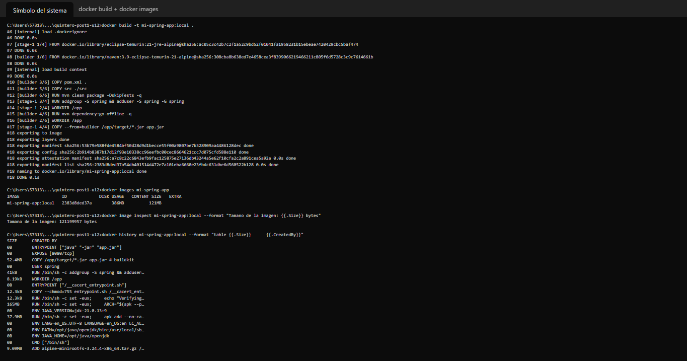
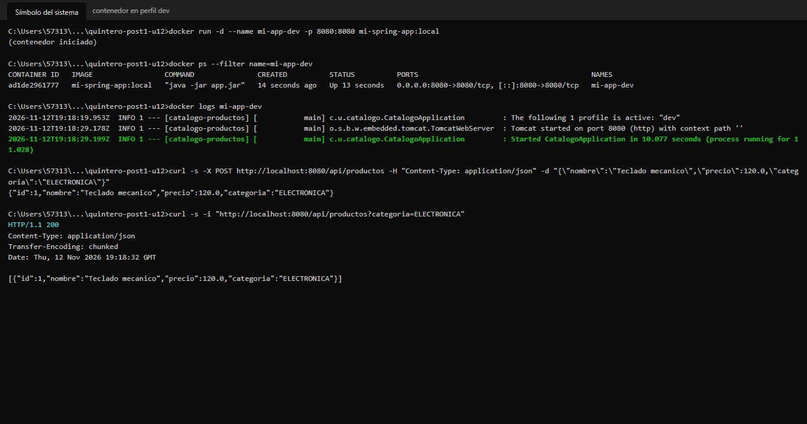
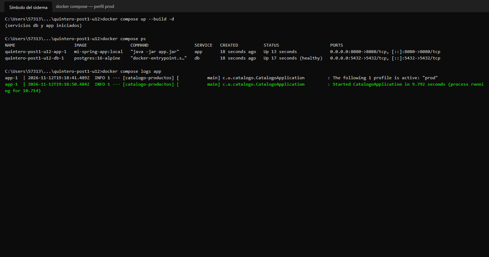
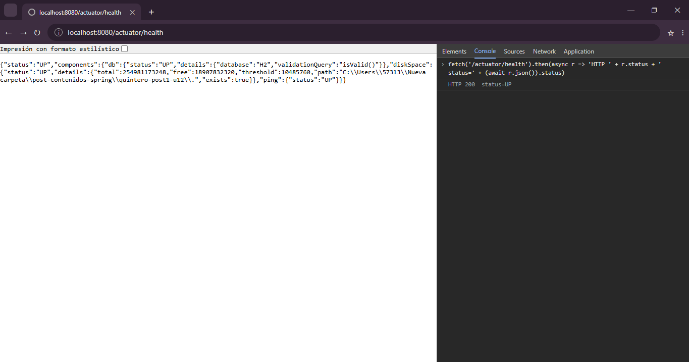
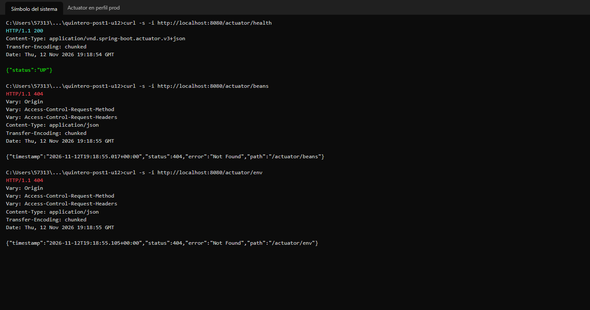
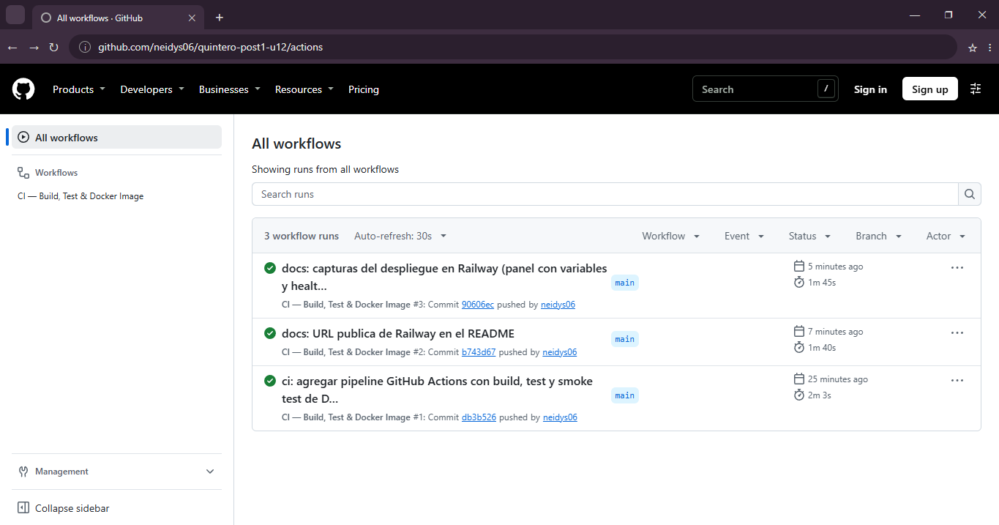
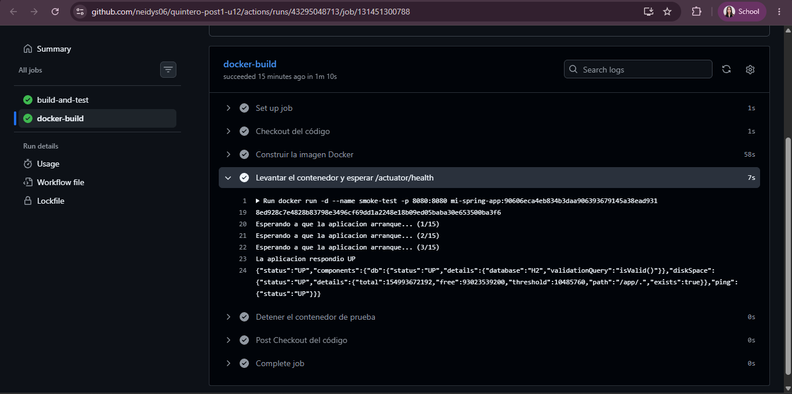
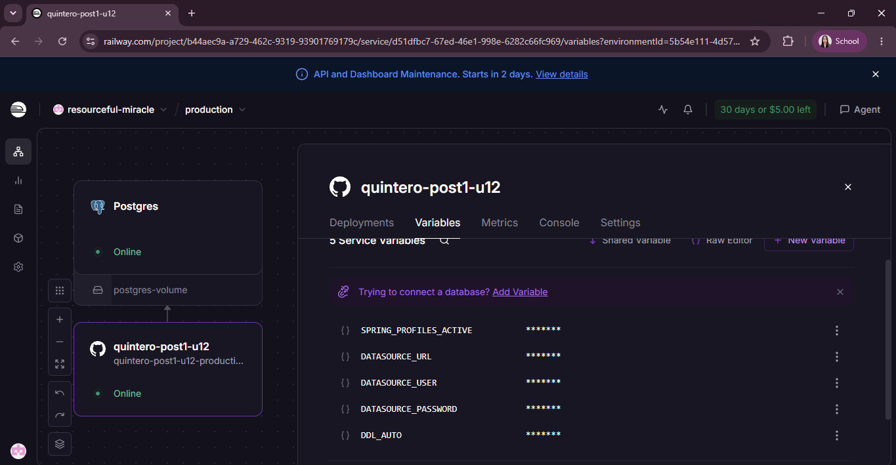
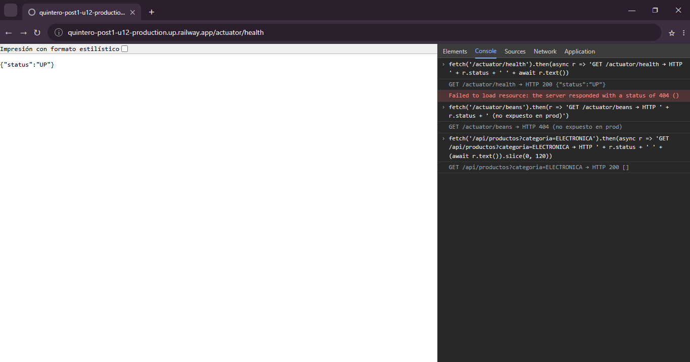

# Post-contenido — Unidad 12: Despliegue y CI/CD


## Descripción

Repositorio del laboratorio de la Unidad 12 de Programación Web — Séptimo
Semestre. Contiene la aplicación Spring Boot `catalogo-productos` (API REST
`/api/productos` con una entidad JPA `Producto` y su suite de pruebas,
traída de la Unidad 10) dockerizada con un **Dockerfile multi-stage** y
perfiles **dev/prod** (Parte 1), y su extensión con un **pipeline de
integración continua con GitHub Actions** y monitoreo con **Spring Boot
Actuator** (Parte 2). El despliegue real en Railway (o Render) se documenta
como paso final.

**Estudiante:** Neidys Mariana Quintero Carrillo

## Tecnologías

Java 21, Spring Boot 3.2 (Web, Data JPA, Validation, Actuator), H2 (dev,
pruebas y smoke test), PostgreSQL (prod), Docker (multi-stage, Eclipse
Temurin), Docker Compose, GitHub Actions, JUnit 5/Mockito/JaCoCo, Railway.

## Estructura

```
quintero-post1-u12/
├── .github/workflows/ci.yml        ← pipeline (build-and-test → docker-build)
├── Dockerfile                      ← multi-stage: Maven+JDK 21 → JRE 21 Alpine, usuario no root
├── .dockerignore                   ← excluye target/, .git/, .github/, .idea/, docs…
├── docker-compose.yml              ← prueba local del perfil prod con PostgreSQL
├── pom.xml
├── postman/                        ← colección de la Unidad 10
├── capturas/  parte-1/  parte-2/
└── src/
    ├── main/java/com/universidad/catalogo/   (model, repository, service, controller)
    ├── main/resources/
    │   ├── application.properties             ← común: PORT y SPRING_PROFILES_ACTIVE
    │   ├── application-dev.properties         ← H2, show-sql, Actuator completo
    │   └── application-prod.properties       ← PostgreSQL, validate, Actuator health/info
    └── test/java/com/universidad/catalogo/   ← ApplicationContextTest + pruebas de la U10
```

## Parte 1 — Dockerización con perfiles y variables de entorno

El Dockerfile multi-stage compila con Maven en la etapa `builder` y ejecuta
el JAR en una etapa **JRE Alpine** con un **usuario no root** (`spring`) y
`ENTRYPOINT ["java", "-jar", "app.jar"]`. `pom.xml` se copia antes que `src/`
para que la capa de dependencias quede en caché. La configuración se
externaliza con placeholders `${VAR:default}`:

| Variable | Archivo | Valor por defecto | Uso |
|---|---|---|---|
| `PORT` | `application.properties` | `8080` | Railway/Render la inyectan |
| `SPRING_PROFILES_ACTIVE` | `application.properties` | `dev` | Elige el perfil |
| `DATASOURCE_URL` | dev / prod | `jdbc:h2:mem:devdb` / `jdbc:postgresql://localhost:5432/appdb` | Conexión |
| `DATASOURCE_USER` | dev / prod | `sa` / `appuser` | Usuario de BD |
| `DATASOURCE_PASSWORD` | dev / prod | vacío (sin valor utilizable en prod) | Contraseña de BD |
| `DATASOURCE_DRIVER` | dev | `org.h2.Driver` | Driver en dev |
| `DDL_AUTO` | prod | `validate` | `update` solo en el primer despliegue sobre una base vacía |

Sin variables, el contenedor arranca en `dev` con H2; con
`SPRING_PROFILES_ACTIVE=prod` y las variables `DATASOURCE_*` arranca contra
PostgreSQL. Este proyecto no usa JWT, por eso no hay `JWT_SECRET`.

## Parte 2 — Pipeline CI/CD con GitHub Actions y monitoreo con Actuator

El workflow `.github/workflows/ci.yml` se activa en cada push o pull request
a `main` y tiene dos jobs encadenados con `needs:`:

| Job | Propósito | Pasos |
|---|---|---|
| `build-and-test` | Garantizar que el código compila y las pruebas pasan antes de producir una imagen. | `actions/checkout@v4` → `actions/setup-java@v4` (Temurin 21, `cache: maven`) → `mvn -B clean verify` (pruebas + umbral JaCoCo) → sube `target/surefire-reports/` como artefacto (`if: always()`, 7 días). |
| `docker-build` | Comprobar que la imagen construida **arranca y está saludable**. Solo corre si el job anterior pasó. | `docker build -t mi-spring-app:${{ github.sha }} .` → `docker run -d --name smoke-test` → hasta 15 consultas a `/actuator/health` cada 2 s esperando `"status":"UP"` (si no llega, imprime `docker logs` y falla) → `docker rm -f smoke-test` con `if: always()`. |

**Actuator:** en `dev` se exponen todos los endpoints
(`management.endpoints.web.exposure.include=*`, detalles de health siempre);
en `prod` solo `health` e `info` (`/actuator/beans` responde 404).

## Despliegue (paso final manual) en Railway

1. En railway.app iniciar sesión con GitHub → **New Project → Deploy from
   GitHub repo** → elegir `quintero-post1-u12`. Railway detecta el
   `Dockerfile` y construye la imagen en su propia infraestructura (el
   workflow de GitHub Actions no interviene ni guarda Secrets de Railway).
2. En el mismo proyecto: **+ New → Database → PostgreSQL**.
3. En el servicio de la aplicación → **Variables**:
   `SPRING_PROFILES_ACTIVE=prod`,
   `DATASOURCE_URL=jdbc:postgresql://${{Postgres.PGHOST}}:${{Postgres.PGPORT}}/${{Postgres.PGDATABASE}}`,
   `DATASOURCE_USER=${{Postgres.PGUSER}}`,
   `DATASOURCE_PASSWORD=${{Postgres.PGPASSWORD}}` y, solo en el primer
   despliegue, `DDL_AUTO=update` (luego se elimina para volver a `validate`).
4. **Settings → Networking → Generate Domain**.
5. Verificar `https://quintero-post1-u12-production.up.railway.app/actuator/health` → `{"status":"UP"}`.

URL de la aplicación: https://quintero-post1-u12-production.up.railway.app
— `/actuator/health` y `/api/productos?categoria=ELECTRONICA`.

## Decisiones de diseño

### Parte 1

1. **Placeholders con valor por defecto (`${VAR:default}`) en vez de
   estrictos (`${VAR}`).** Un placeholder estricto obliga a exportar todas las
   variables incluso en local o en CI y falla al arrancar si falta una. Con
   defaults seguros (H2 en memoria) el mismo artefacto arranca sin fricción
   en la máquina local y en GitHub Actions, y en producción Railway
   sobrescribe cada valor. No se da un default utilizable a la contraseña de
   producción.
2. **`application-dev.properties` y `application-prod.properties` como
   archivos separados**, en lugar de un único archivo con bloques
   `spring.config.activate.on-profile`: el nombre del archivo deja explícito
   a qué ambiente pertenece cada valor y reduce el riesgo de editar
   producción por error.
3. **Imagen final `eclipse-temurin:21-jre-alpine` en vez del JDK completo o
   distroless.** Sin compilador ni herramientas de build, la imagen es mucho
   más pequeña (medida: 265 MB descomprimida y 121 MB comprimida, por
   debajo del objetivo de 300 MB) y, a diferencia de distroless, conserva
   un shell para depurar con `docker exec -it`.
4. **Etapa de compilación con `maven:3.9-eclipse-temurin-21-alpine`.** La
   imagen `eclipse-temurin:21-jdk-alpine` trae el JDK pero no el comando
   `mvn`, así que `RUN mvn dependency:go-offline` fallaría; la imagen oficial
   de Maven incluye ambos sobre el mismo Temurin 21.
5. **`ddl-auto=validate` en prod, configurable con `DDL_AUTO`.** En
   producción Hibernate no debe modificar el esquema, pero una base recién
   creada en Railway está vacía y `validate` haría fallar el arranque; por
   eso el primer despliegue usa `DDL_AUTO=update` de forma explícita.

### Parte 2

1. **Prueba mínima de contexto (`ApplicationContextTest`) además de las
   pruebas existentes.** Un job de pruebas sin aserciones "pasaría" sin
   validar nada; esta prueba obliga a Spring a construir todos los beans con
   el perfil `dev` y comprueba que ese es el perfil activo, antes de pasar al
   job de Docker.
2. **El job `docker-build` construye y verifica la imagen, pero no la
   publica en un registro** (Docker Hub, GHCR). Publicar exigiría Secrets de
   una cuenta externa solo para que el pipeline pase; el smoke test valida lo
   importante —que la imagen arranca y expone el endpoint de monitoreo— y
   Railway construye su propia imagen desde el mismo Dockerfile.
3. **Exposición de Actuator diferenciada por perfil**: todo en `dev` para
   diagnosticar; solo `health` e `info` en `prod` para no exponer en
   Internet beans, variables de entorno ni configuración.
4. **`needs: build-and-test`, caché de Maven y limpieza con `if: always()`**:
   no se gasta tiempo construyendo imágenes de código roto, las dependencias
   no se descargan en cada ejecución y el contenedor de prueba siempre se
   elimina, falle o no el smoke test.

## Cómo compilar y ejecutar

```bash
git clone https://github.com/neidys06/quintero-post1-u12.git
cd quintero-post1-u12

# 1. Sin Docker
mvn clean package -DskipTests
java -jar target/catalogo-0.0.1-SNAPSHOT.jar

# 2. Imagen local
docker build -t mi-spring-app:local .
docker images mi-spring-app                       # CONTENT SIZE 121MB
docker history mi-spring-app:local                # capas: 9 + 38 + 165 + 52 MB ≈ 265 MB

# 3. Perfil dev (valores por defecto, H2)
docker run -d --name mi-app-dev -p 8080:8080 mi-spring-app:local
curl http://localhost:8080/actuator/health        # {"status":"UP",...}
curl "http://localhost:8080/api/productos?categoria=ELECTRONICA"
docker stop mi-app-dev && docker rm mi-app-dev

# 4. Perfil prod con PostgreSQL (Docker Compose levanta la BD y la app)
docker compose up --build -d
docker compose logs app | grep "profile is active"  # The following 1 profile is active: "prod"
curl http://localhost:8080/actuator/health        # {"status":"UP"}
curl -i http://localhost:8080/actuator/beans      # 404 en prod
docker compose down

# 4b. Alternativa sin Compose (PostgreSQL ya corriendo en la máquina)
docker run -d --name mi-app-prod -p 8080:8080 \
  -e SPRING_PROFILES_ACTIVE=prod \
  -e DATASOURCE_URL=jdbc:postgresql://host.docker.internal:5432/appdb \
  -e DATASOURCE_USER=appuser -e DATASOURCE_PASSWORD=apppass \
  -e DDL_AUTO=update \
  mi-spring-app:local
docker logs -f mi-app-prod
```

El pipeline se consulta en la pestaña **Actions** del repositorio.

## Capturas de pantalla

### Parte 1

**`docker build` exitoso y tamaño de la imagen < 300 MB.** `docker image inspect` reporta 121 MB (contenido comprimido) y `docker history` suma ≈ 265 MB de capas descomprimidas (alpine 9 MB + paquetes 38 MB + JRE 165 MB + JAR 52 MB). El valor `DISK USAGE` de 386 MB que muestra `docker images` corresponde a la suma de ambas copias que guarda Docker Desktop (contenido comprimido + capas descomprimidas), no al tamaño de la imagen.


**Contenedor en perfil dev respondiendo `/api/productos`**


**Logs del contenedor con el perfil `prod` activo**


### Parte 2

**`/actuator/health` respondiendo UP en local**


**`/actuator/beans` responde 404 en prod**


**Historial de GitHub Actions con al menos 3 ejecuciones en verde**


**Log del smoke test: "La aplicacion respondio UP"**


**Panel de Railway con el despliegue activo y las variables configuradas**


**`/actuator/health` respondiendo UP en la URL pública**


## Referencias

- Docker. *Multi-stage builds*. https://docs.docker.com/build/building/multi-stage/
- Docker. *Dockerfile best practices*. https://docs.docker.com/build/building/best-practices/
- Spring. *Spring Boot Reference 3.2 — Externalized Configuration y Profiles*. https://docs.spring.io/spring-boot/docs/3.2.x/reference/html/features.html#features.external-config
- Spring. *Spring Boot Reference 3.2 — Actuator Endpoints*. https://docs.spring.io/spring-boot/docs/3.2.x/reference/html/actuator.html
- GitHub. *GitHub Actions — Workflow syntax*. https://docs.github.com/actions/using-workflows/workflow-syntax-for-github-actions
- GitHub. *actions/setup-java — caching dependencies*. https://github.com/actions/setup-java#caching-packages-dependencies
- Railway. *Dockerfiles* y *Variables*. https://docs.railway.com/guides/dockerfiles
